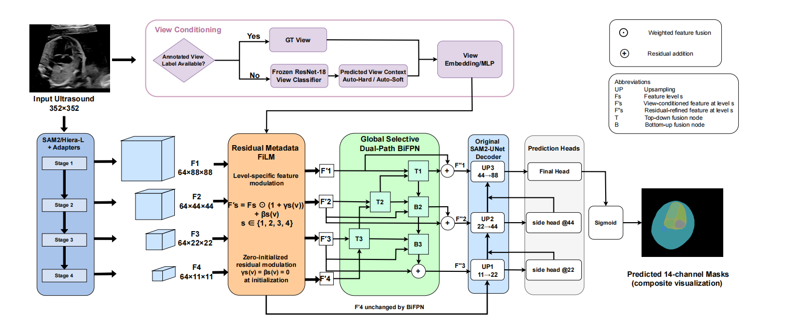

# VC-SAM2-UNet

**View-Conditioned SAM2-UNet for Multi-Label Fetal Cardiac Ultrasound Segmentation**  
Manuscript prepared for IECBES 2026. This repository does not claim acceptance, publication, or a DOI.

**Authors:** Ziqi Zhao, Zhenghao Jiang, Camilla Fazi, Netzahualcoyotl Hernandez-Cruz

**Affiliations:** Academy of Artificial Intelligence and Advanced Technology, Xi’an Jiaotong-Liverpool University; Department of Neurosciences, Psychology, Drug Research and Child Health, University of Florence; Division of Neonatology, Careggi University Hospital of Florence. Ziqi Zhao and Zhenghao Jiang are equal contributors; Netzahualcoyotl Hernandez-Cruz is corresponding author.

  

> Repository status: public research code release. The dataset, checkpoints, and exact licensed SAM2 runtime are not bundled. See [reproduction status](docs/reproduction_status.md) before interpreting the results.

## Overview

VC-SAM2-UNet extends SAM2-UNet for four-view, 14-channel fetal cardiac ultrasound segmentation. The full model keeps the SAM2/Hiera encoder, adapters, receptive-field blocks, and U-Net decoder, and adds two components:

- **Residual Metadata-FiLM (RMF):** conditions four multiscale features on a view representation.
- **Global Selective Dual-Path BiFPN (GSDB):** fuses the conditioned multiscale features through learned top-down and bottom-up paths.

The view can be an annotated GT view, a frozen ResNet-18 argmax prediction (Auto-Hard), or the four classifier probabilities (Auto-Soft). Auto-Hard and Auto-Soft reuse the same full segmentation checkpoint; they are inference modes, not separately trained segmentation networks.



This architecture figure is reproduced from the user-provided manuscript image. It includes the manuscript's ultrasound input example and a composite mask visualization; no dataset, case identifier, or checkpoint is included.

## Main Contributions

1. Residual Metadata-FiLM injects four-way acquisition-view context into multiscale SAM2-UNet features with zero-initialized residual projections.
2. Global Selective Dual-Path BiFPN provides learned bidirectional multiscale feature fusion.
3. A frozen ResNet-18 view classifier supports GT View, Auto-Hard, and Auto-Soft inference using the same Full segmentation checkpoint.
4. A 14-channel validity-mask protocol supports overlapping labels and partial annotations.

## Components and Evaluation Modes

| ID | Configuration | View input | RMF | GSDB |
|---|---|---|---:|---:|
| A0 | SAM2-UNet baseline | None | No | No |
| A1 | Metadata-FiLM only | GT view | Yes | No |
| A2 | Selective DPBiFPN only | None | No | Yes |
| A3 | Full VC-SAM2-UNet | GT view | Yes | Yes |
| A3 Auto-Hard | Full model, frozen view argmax | Predicted class | Yes | Yes |
| A3 Auto-Soft | Full model, frozen view probabilities | Four probabilities | Yes | Yes |

The A1 and A3 FiLM paths consume the GT view during segmentation training. Auto modes are evaluated with a validation-selected, frozen ResNet-18 classifier. For the reported full-model test comparison, the segmentation checkpoint is shared across GT View, Auto-Hard, and Auto-Soft.

## Results

### Component Ablation

Validation entries are mean ± sample standard deviation over the same ten seeds for each configuration. Fixed-test scores use each configuration's validation-selected SeedMax checkpoint and the 179-image test set.

| Configuration | Validation Dice (10 seeds) | SeedMax | Best epoch | Test Dice | Test IoU |
|---|---:|---:|---:|---:|---:|
| SAM2-UNet baseline | 0.7878 ± 0.0048 | 9102 | 70 | 0.7908 | 0.6616 |
| + Metadata-FiLM (RMF) | 0.8231 ± 0.0024 | 5772 | 39 | 0.8135 | 0.6910 |
| + Selective DPBiFPN (GSDB) | 0.7874 ± 0.0046 | 1337 | 68 | 0.7998 | 0.6734 |
| + Both components (Full) | 0.8204 ± 0.0051 | 1337 | 71 | 0.8214 | 0.7021 |

The full model's fixed-test Dice difference is `0.8214 - 0.7908 = 0.0306`, i.e. **3.06 Dice percentage points**, not a 3.06% relative improvement.

### Full-Model View Modes

| View mode | Segmentation seed | Test images | Test Dice | Test IoU |
|---|---:|---:|---:|---:|
| GT View | 1337 | 179 | 0.8214 | 0.7021 |
| Auto-Hard | 1337 | 179 | 0.8131 | 0.6900 |
| Auto-Soft | 1337 | 179 | 0.8065 | 0.6815 |

These values are transcribed from and checked against the final XEC aggregate CSVs. Machine-readable tables are in [`results/`](results/). No Dice-to-IoU conversion was used. See [source and limitations](docs/reproduction_status.md).

## Qualitative Results and Figures

The architecture figure above is reproduced from the paper image supplied for this repository. Separate case-level qualitative panels, Grad-CAM maps, and confusion figures are not included.

## Method and Protocol

- Dataset: 893 images, split 625 train / 89 validation / 179 fixed test.
- Views: 4CHV, LVOT, RVOT, and 3VTV.
- Output: 14 independent sigmoid channels; overlapping masks are allowed.
- Segmentation input: grayscale image converted to RGB, resized directly to 352×352 with bilinear interpolation, then ImageNet-normalized. No crop or aspect-preserving pad is used for segmentation.
- Mask input: each binary mask resized to 352×352 with nearest-neighbor interpolation.
- Partial labels: a per-image, per-channel validity mask excludes unknown channels from loss and metrics.
- Training: 100 epochs, batch size 2, AdamW (`5e-4`, weight decay `1e-4`), cosine schedule to `5e-6`, deterministic horizontal-flip plan, masked BCE+Dice deep supervision over final and two side outputs.
- Model selection: maximum validation macro Dice; test scores do not select checkpoints.
- Fixed test: sigmoid threshold 0.5, same 179 images and validity-mask protocol, no TTA, calibration, VAP, threshold tuning, or post-processing.
- Evaluation loader: `model.eval()`, `shuffle=False`, `drop_last=False`.

Classifier preprocessing differs from segmentation preprocessing: resize to fit inside 224×224 while preserving aspect ratio, zero-pad to a square, and apply ImageNet normalization. Exact settings are summarized in [`configs/paper_protocol.json`](configs/paper_protocol.json).

To plot the aggregate test table without loading images, masks, or checkpoints:

```bash
python visualization/plot_paper_results.py --output /path/to/figures/fixed_test_summary.png
```

## Installation

The original XEC environment used Python 3.10.20, PyTorch 2.5.1+cu124 (CUDA build 12.4), and torchvision 0.20.1+cu124. The original runtime used a project-local third-party SAM2 fork at commit `c2549321706fa290b10f9e94227b71ebf7512524`; its license could not be verified, so it is not redistributed. The install command below points to official Meta SAM 2 at a pinned commit as a licensed alternative, but equivalence and checkpoint compatibility have not been certified. See [`docs/environment.md`](docs/environment.md).

```bash
python -m venv .venv
source .venv/bin/activate
python -m pip install --upgrade pip
python -m pip install -r requirements.txt
python -m pip install "git+https://github.com/facebookresearch/sam2.git@2b90b9f5ceec907a1c18123530e92e794ad901a4"
```

The SAM2 Hiera Large initialization weights are distributed separately by their respective rights holder. Do not place them in this repository. The model code expects the SAM 2 configuration `sam2_hiera_l.yaml` to be available in the installed SAM 2 package.

## Data Preparation

The D10 images, masks, case-level metadata, and split manifests are not included. Obtain written authorization and place them in a private location. The required columns and folder contract are documented in [`docs/data_contract.md`](docs/data_contract.md). The public label order and view-to-label rules are in `configs/`.

```bash
python data_processing/validate_manifest.py \
  --data-root /path/to/authorized/d10-root \
  --split-root /path/to/authorized/splits
```

The validator reports counts only; it does not print sample IDs. The expected split counts are 625/89/179. Do not create a new split using test outcomes.

## Training

All runs require the authorized dataset and `sam2_hiera_large.pt`. Training scripts do not evaluate test images. Each command must use a fresh output directory.

Baseline or full model (A0/A3):

```bash
python train/train_d10_v3_segmentation.py \
  --method baseline \
  --seed 9102 \
  --epochs 100 \
  --data-root /path/to/authorized/d10-root \
  --split-root /path/to/authorized/splits \
  --pretrained /path/to/sam2_hiera_large.pt \
  --label-map configs/label_map.json \
  --view-rules configs/view_label_rules.json \
  --output-dir /path/to/new-runs/A0_seed9102
```

Set `--method p1_gt_view` for A3. Seeds are explicit; use the preregistered ten-seed list for a ten-seed reproduction. The validation-best checkpoint is saved as `best_checkpoint.pt`.

Single-component ablations (A1/A2):

```bash
python train/train_component_ablation.py \
  --method A1_film_only \
  --seed 5772 \
  --epochs 100 \
  --data-root /path/to/authorized/d10-root \
  --split-root /path/to/authorized/splits \
  --pretrained /path/to/sam2_hiera_large.pt \
  --label-map configs/label_map.json \
  --view-rules configs/view_label_rules.json \
  --output-dir /path/to/new-runs/A1_seed5772
```

Use `--method A2_dpbifpn_only` for A2. The A1/A2 script keeps the formal single-component ablation model/state-dict layout.

View classifier training (only when reproducing classifier development):

```bash
python train/train_view_classifier.py \
  --method V0_resnet18 --seed 3407 \
  --data-root /path/to/authorized/d10-root \
  --split-root /path/to/authorized/splits \
  --run-dir /path/to/new-runs/view_resnet18_seed3407
```

Classifier selection is validation-only. For the reported automatic-view inference, the frozen validation-selected ResNet-18 checkpoint is needed separately; it is not included.

## Fixed-Test Evaluation

Test evaluation requires a validation-selected segmentation checkpoint. Auto modes additionally require the frozen View-classifier checkpoint. The command refuses `last_checkpoint.pt`, uses strict state-dict loading, and writes outputs to a new directory.

```bash
python eval/evaluate.py \
  --method A3 --view-mode gt \
  --checkpoint /path/to/A3/best_checkpoint.pt \
  --pretrained /path/to/sam2_hiera_large.pt \
  --data-root /path/to/authorized/d10-root \
  --split-root /path/to/authorized/splits \
  --test-split /path/to/authorized/splits/test.csv \
  --output-dir /path/to/new-eval/A3_GT
```

Use `--view-mode auto-hard` or `--view-mode auto-soft` and add `--view-checkpoint /path/to/frozen_view_best_checkpoint.pt` for automatic modes. Use `--method A0`, `A1`, or `A2` with `--view-mode none` for the other configurations. Optional `--write-per-image` writes only anonymous test ordinals, not sample identifiers.

The test command is intentionally separate from seed selection. Select each configuration's checkpoint using validation results first, record the selection, then run fixed test once.

## Repository Layout

```text
assets/                 manuscript architecture figure
configs/                public label/view maps and frozen protocol
data_processing/        dataset reader and private-manifest validator
models/                  baseline, full, ablation, and classifier definitions
train/                   baseline/full, component-ablation, and classifier entrypoints
eval/                    fixed-test runner and partial-label metrics
results/                 aggregate paper tables only
tests/                   synthetic protocol and metric tests
docs/                    provenance, private data contract, limitations
third_party/licenses/    retained upstream Apache-2.0 license texts
```

## Data, Checkpoints, and Privacy

No original ultrasound, masks, split/case manifest, trained checkpoint, prediction, private log, SSH material, or HPC path is included. Do not upload such files without explicit data-holder and institutional authorization. Model initialization weights and trained checkpoints must be obtained separately from their authorized owners.

The supplied manuscript architecture figure includes one ultrasound input example and a composite mask visualization. No dataset images, case-level qualitative panels, Grad-CAM maps, or confusion figures are bundled separately.

The repository is currently private and has no project-level license. Third-party license texts are retained for the upstream components. Do not add MIT or another project license until all authors/institutional owners approve the release terms.

## Citation

```bibtex
@inproceedings{zhao2026vcsam2unet,
  title     = {VC-SAM2-UNet: View-Conditioned SAM2-UNet for Multi-Label Fetal Cardiac Ultrasound Segmentation},
  author    = {Zhao, Ziqi and Jiang, Zhenghao and Fazi, Camilla and Hernandez-Cruz, Netzahualcoyotl},
  booktitle = {IECBES 2026},
  year      = {2026},
  note      = {Manuscript; publication status and DOI not asserted}
}
```

Please also cite the upstream [SAM2-UNet](https://github.com/WZH0120/SAM2-UNet) and [SAM 2](https://github.com/facebookresearch/sam2) projects. The upstream attribution and license notes are in `third_party/`.

## Acknowledgements

We acknowledge the authors of SAM2-UNet and Meta's SAM 2 for the upstream segmentation architecture and foundation-model implementation. Their software is subject to the licenses and notices included in `third_party/`.

## Medical Disclaimer

This research code is for research and educational use. It is not a medical device and must not be used for diagnosis, treatment, or clinical decision-making. Clinical deployment requires independent validation, regulatory review, and appropriate data governance.
